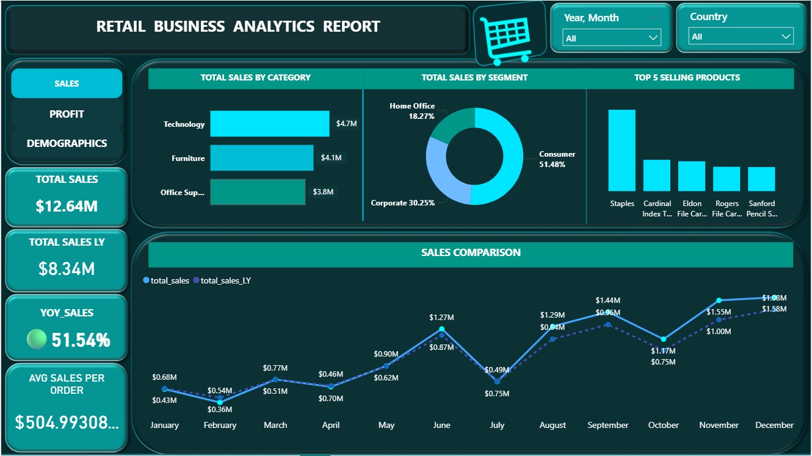
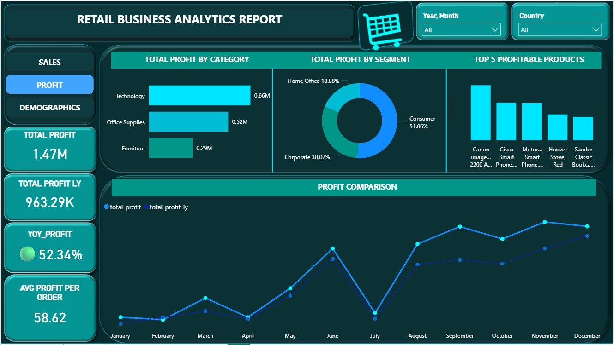
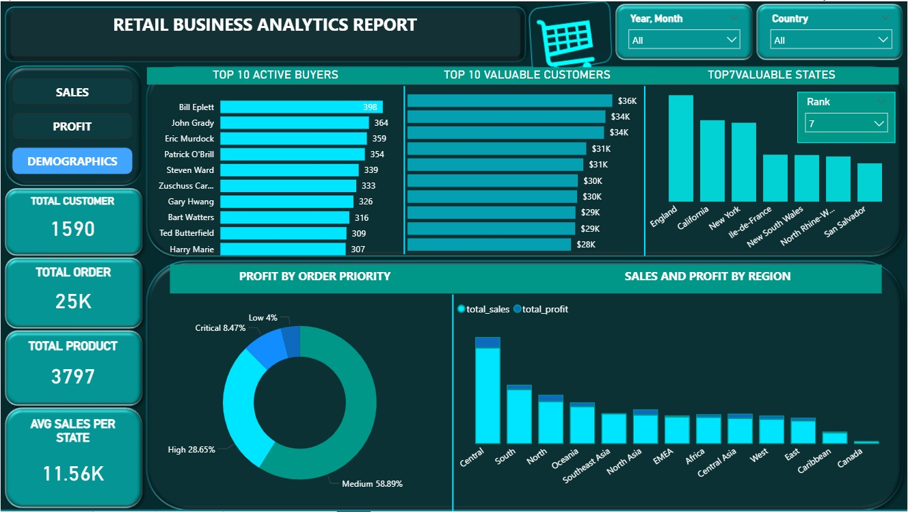

# Retail Business Analytics Dashboard

## 📊 Project Overview
An interactive Power BI dashboard analyzing retail sales, profitability, and customer behavior to generate actionable business insights.

## 🛠️ Tools & Technologies
- Power BI
- DAX
- Power Query
- Microsoft Excel

## 📈 Dashboard Pages

### 1. Sales Analysis
Analyzes sales by product category, customer segment, top-selling products, and monthly trends.

### 2. Profit Analysis
Analyzes profit by category, customer segment, profitable products, and monthly trends.

### 3. Customer Demographics
Explores active customers, valuable customers, state-wise performance, and regional sales and profit.

## 💡 Key Insights
- Identified top-performing product categories.
- Compared profitability across customer segments.
- Analyzed customer and regional performance.
- Explored monthly sales and profit trends.

## 👩‍💻 Author
Athira Mohan

Data Analyst | Power BI | SQL | Python | Excel
